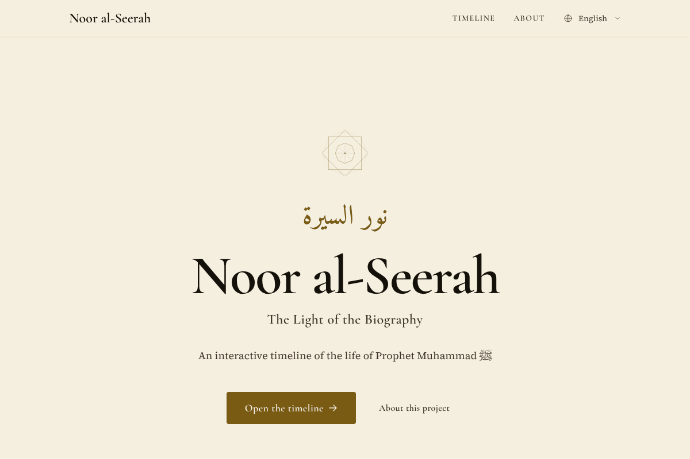
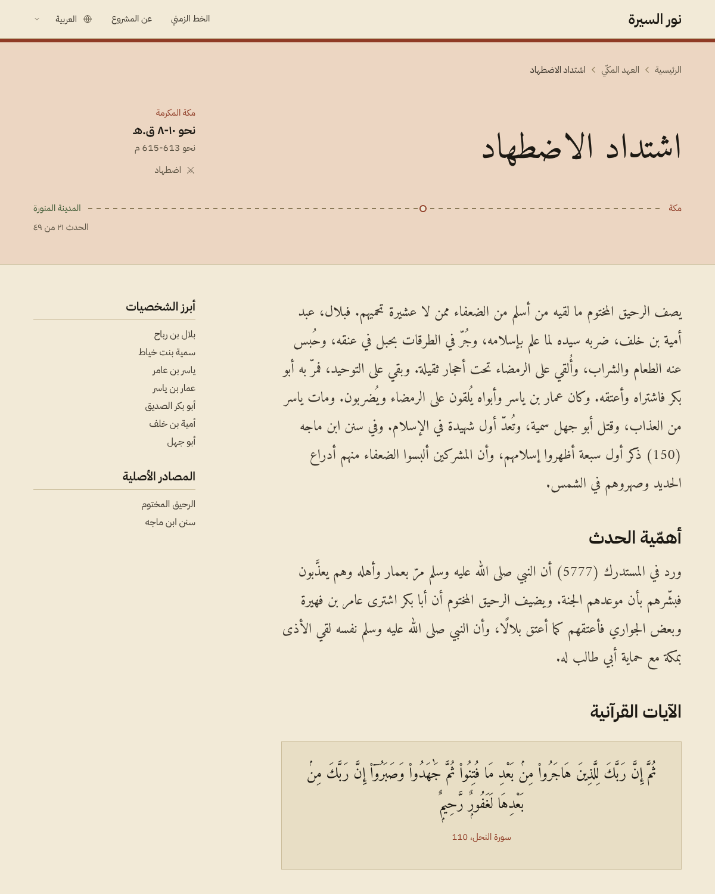

# Noor al-Seerah

A timeline of the life of Prophet Muhammad ﷺ, in English, Arabic, and French. Forty-nine events across three eras, each with its place, date, summary, and the reasons it matters in all three languages, and a list of the sources it draws on. The timeline reads as a ledger of dates beside a dashed route from Makkah to Madinah. English is the source of record. Content lives in JSON and the application only renders it.

| Era | Events |
|---|---|
| Before Prophethood | 14 |
| The Makkan Period | 18 |
| The Madinan Period | 17 |





## What is on a page

- **Qur'an passages** (36 across the events) are published editions fetched by `npm run fetch:scripture`: Uthmani for Arabic, Saheeh International for English, Hamidullah for French. Nothing is translated here, and the three columns always describe the same ayah range.
- **Hadith** (54 references, 50 distinct narrations) show the Arabic and the English as sunnah.com publishes them for that collection and number. French pages show the English, because sunnah.com publishes no French, and say so. Two narrations that no sunnah.com collection carries have an English and French rendering made for this project, and each is labelled. Where only part of a narration is shown, the page says that too. Every hadith shows a grading: 48 sahih, 3 hasan, 1 hasan sahih, 1 da'if, 1 mursal.
- **Citation record.** `data/citation-review.json` records, for each of the 50 narrations, what was read under that number: 48 at sunnah.com and 2 at dorar.net. The build fails if a narration has no entry.
- **Proper nouns** (people, groups, works, months, surahs) resolve through registries in `src/config`, so Arabic pages do not fall back to Latin script mid-sentence. The build fails on a name with no Arabic or French form.
- **Nothing is requested from another origin at runtime.** Fonts are self-hosted and the content security policy sets `connect-src 'self'`.
- **Share cards** are rendered at build time for every event in every language (147 images): the era name on a solid strip, then the place, title, and date. Arabic is set in visual order.

## Stack

- Next.js 16.4 (App Router, Turbopack)
- React 19.3
- TypeScript 5.9
- Tailwind CSS 4.3 with CSS-first tokens
- next-intl 4.14 for routing and messages
- Alegreya, IBM Plex Sans, Amiri, and IBM Plex Sans Arabic, self-hosted through `next/font`

## Run it

Node 20.9 or newer.

```bash
npm install
npm run dev
```

The app runs at `http://localhost:3000`. English is at `/`, Arabic at `/ar`, French at `/fr`.

| Command | What it does |
|---|---|
| `npm run build` | Runs both verify scripts, then builds. Must finish without warnings. |
| `npm run start` | Serves the production build. |
| `npm run lint` | ESLint with the Next.js core-web-vitals preset. |
| `npm run typecheck` | `tsc --noEmit`. |
| `npm run verify:citations` | Every cited hadith has a review entry and every entry is still cited. |
| `npm run verify:names` | Every proper noun has an Arabic and a French form. |
| `npm run fetch:scripture` | Refetches Qur'an text from the published editions. `--check` compares without writing. |

To check that no language leaks into another, scan a production build:

```bash
npm run build && npx next start -p 3000
LOCALES=ar,fr node scripts/verify-locales.mjs http://localhost:3000 / /timeline /about
```

## Configuration

`NEXT_PUBLIC_SITE_URL` sets the origin used in canonical links, alternate-language links, the sitemap, and share cards. It defaults to `https://noor-al-seerah.vercel.app`; set it to the deployed origin when that differs.

## Deploying

The site is fully static apart from one catch-all route that answers unknown paths with a localised 404. It deploys to Vercel without extra configuration: security headers are set in `next.config.mjs`, which is the only place they live.

## More

- [Sources and methodology](docs/SOURCES.md)
- [Architecture](docs/ARCHITECTURE.md)
- [Internationalisation](docs/I18N.md)

## License

MIT.
